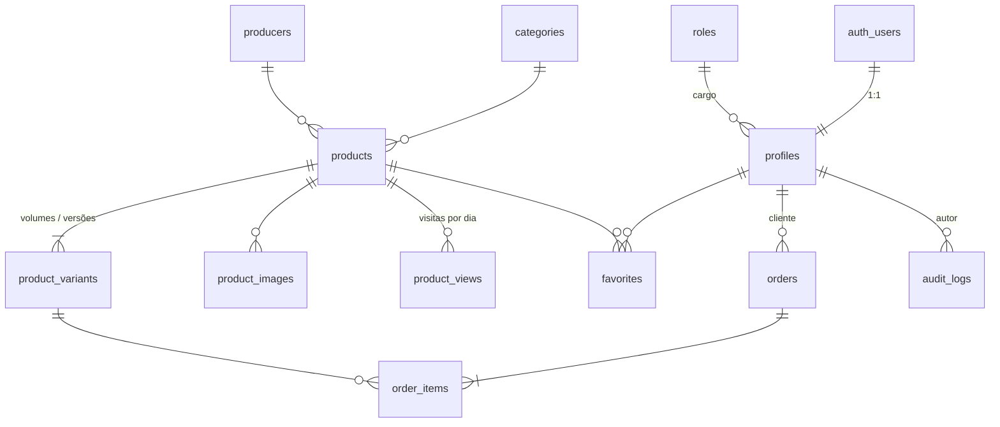

# Banco de dados

Postgres no Supabase. Autenticação pelo Supabase Auth, imagens no Storage (bucket `catalog`) e todo o controle de acesso feito por RLS no próprio banco. A aplicação nunca depende só da interface para proteger dados.

Migrations em `supabase/migrations`, catálogo inicial em `supabase/seed.sql` e dados de demonstração (apenas local) em `supabase/seeds/demo.sql`.

## Diagrama



## Tabelas

| Tabela | Para que serve | Pontos importantes |
| --- | --- | --- |
| `roles` | Cargos do painel | `permissions text[]` com valores validados por constraint. Cargos `is_system` não podem ser apagados nem ter permissões alteradas |
| `profiles` | Dados do usuário (empresa cliente ou equipe) | Criado por trigger no cadastro. `role_id` nulo = cliente. Clientes são empresas: `company_name`, `tax_id` (CNPJ/CPF) e `business_type` (adega, mercado, restaurante, vinícola…). O cliente só altera esses dados e nome/telefone (grant por coluna) |
| `categories` | Estilos: tintos, brancos, rosés, espumantes... | `accent` define a cor usada no site e no dashboard |
| `producers` | Vinícolas | País e região padrão |
| `products` | O vinho | Uvas (`text[]`), doçura, safra, teor, temperatura, harmonização, perfil sensorial 1–5 (corpo, acidez, tanino, doçura), selo e destaque. `search_text` sem acento indexado com trigram para busca parcial |
| `product_variants` | Versões vendáveis (750 ml, 1 L, Seco/Suave, Merlot/Tannat...) | Preço, preço promocional, estoque e SKU ficam aqui. Preço nulo = "sob consulta" |
| `product_images` | Galeria | `path` aceita caminho local (`/products/x.webp`) ou URL do Storage |
| `banners` | Carrossel da home | Janela de exibição opcional (`starts_at`/`ends_at`) e tema visual |
| `favorites` | Lista de desejos do cliente | Chave composta usuário + produto |
| `orders` / `order_items` | Pedidos enviados pelo catálogo | Número sequencial a partir de 1001. Guarda a empresa (`customer_company`) e, nos itens, nome e preço do momento da compra |
| `product_views` | Visitas por produto por dia | Agregado (uma linha por produto/dia) para não crescer sem controle |
| `store_settings` | Dados da loja (WhatsApp, telefone, Instagram) e preferências da plataforma (`show_prices`) | Linha única (`id = 1`) |
| `audit_logs` | Histórico de alterações do painel | Preenchido por triggers, somente leitura para a aplicação |

Views (security invoker, respeitam RLS):

- `catalog_products`: produto + categoria + vinícola + primeira imagem + menor preço + estoque total + variação padrão. É o que a vitrine e as listagens consomem.
- `customer_summaries`: empresas clientes com tipo, CNPJ, quantidade de pedidos, total comprado e último pedido.

## Permissões

| Chave | Libera |
| --- | --- |
| `*` | Tudo (Administrador) |
| `dashboard.view` | Dashboard e histórico |
| `products.manage` | Produtos, variações, imagens e estoque |
| `catalog.manage` | Categorias, vinícolas e banners |
| `orders.manage` | Ver e atualizar pedidos |
| `customers.view` | Lista de clientes |
| `users.manage` | Equipe: convidar, trocar cargo, desativar |
| `roles.manage` | Criar e editar cargos |
| `settings.manage` | Dados da loja |

Cargos criados na instalação: **Administrador** (`*`, sistema), **Gerente**, **Vendedor** e **Estoquista**.

## Regras de segurança

- `has_permission(text)` e `is_staff()` são `security definer` e usadas em todas as policies.
- Público (anon) lê apenas produtos, categorias, vinícolas e banners ativos.
- Cliente lê só o próprio perfil, os próprios pedidos e favoritos.
- Pedido só é criado pela função `place_order`, que recalcula preço no banco, valida disponibilidade e limita 10 pedidos/hora por cliente. Não existe `insert` direto em `orders`.
- Troca de cargo só pela função `admin_update_member`: exige `users.manage`, impede alterar o próprio acesso, impede conceder `*` sem ser administrador e garante ao menos um administrador ativo.
- Apenas administradores criam cargos com `*` (trigger `guard_role_escalation`).
- Upload no bucket `catalog` exige `products.manage` ou `catalog.manage`; leitura é pública.
- Visitas registradas por `track_product_view`, que só conta produtos ativos.

## Funções

| Função | Uso |
| --- | --- |
| `place_order(items jsonb, notes text)` | Cria pedido a partir da sacola. `items = [{ variant_id, quantity }]` |
| `track_product_view(product uuid)` | Soma uma visita ao produto no dia |
| `dashboard_metrics(period_days int)` | Todas as métricas do dashboard em um JSON: KPIs com período anterior, série diária, receita por dia da semana (atual × anterior), garrafas por estilo, origem dos vinhos vendidos, status, mais vendidos, mapa do estoque, mapa de calor por dia/hora, pedidos recentes e atividade |
| `admin_update_member(target, new_role, is_active)` | Altera cargo/ativação de um membro |
| `admin_save_product(payload jsonb)` | Salva produto, variações e imagens numa única transação (roda com as permissões de quem chama) |
| `admin_adjust_stock(variant, quantity)` | Ajusta o estoque de uma variação |

## Primeiro administrador em produção

1. Crie o usuário em **Authentication → Users** no painel do Supabase.
2. No SQL Editor:

```sql
update public.profiles
set role_id = (select id from public.roles where name = 'Administrador')
where email = 'seu-email@dominio.com';
```
